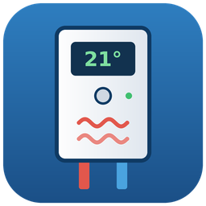
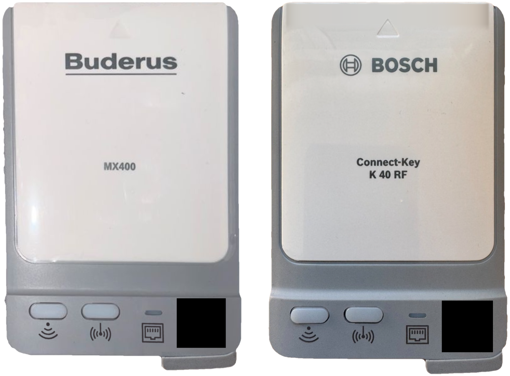

# ioBroker.bosch-buderus-wp

**[🇬🇧 English version](../../README.md)**

## Buderus-MX400- / Bosch-K-40-RF-Adapter für ioBroker

Dieser Adapter liest die Daten einer **Wärmepumpe** (Buderus und andere) über die offizielle **lokale API** des **LAN- und Funkmoduls Buderus MX400 / Bosch K 40 RF** aus. Die Verbindung läuft direkt in deinem Heimnetz, ein Cloud-Konto ist nicht nötig.



*Das Buderus LAN- und Funkmodul MX400 (links) und der Bosch Connect-Key K 40 RF (rechts). Mit diesem Modul kommuniziert der Adapter, getestet wurde er mit dem MX400.*

Das MX400 ist das Internet-Gateway und Funkmodul der Heizungsanlage. Es steckt in einem Steckplatz der Wärmepumpe und verbindet sie per LAN oder WLAN mit dem Heimnetz. Laut Hersteller bieten auch der Bosch Connect-Key K 40 RF sowie der K 40 RF von IVT, Vulcano und Worcester dieselbe lokale API an. Entwickelt und getestet wurde der Adapter mit einem Buderus MX400.

Hersteller: [Buderus](https://www.buderus.de) · [Produktinformation zum MX400 (Buderus, PDF)](https://www.buderus.de/resource/blob/84532/5f174d97fdbaf3201210da560b2364a7/18_Buderus_ISH-2025_LAN-%20und-Funkmodul-MX400.pdf)

> **Hinweis:** Die API des Herstellers ist derzeit **nur lesend**. Der Adapter kann alle Werte anzeigen, aber keine Einstellungen an der Wärmepumpe ändern.

## Funktionen

- **Liest automatisch alle verfügbaren Werte.** Beim Start prüft der Adapter alle Ressourcen aus der API-Beschreibung des Herstellers und legt nur für die Werte Datenpunkte an, die deine Anlage tatsächlich liefert. Zusätzlich werden alle Signale gelesen, die das Gerät selbst meldet.
- **Namen in 11 Sprachen** für alle Datenpunkte (Englisch, Deutsch, Russisch, Portugiesisch, Niederländisch, Französisch, Italienisch, Spanisch, Polnisch, Ukrainisch, Chinesisch), mit den passenden Einheiten (°C, kWh, %, l/h …) und Rollen
- **Energiezähler** (z. B. Gesamtverbrauch, Heizen, Warmwasser) als einzelne Datenpunkte für erzeugte Wärme, Verdichter und Heizstab
- **Verlaufsdaten** zu Verbrauch, Starts, Laufzeiten und Temperaturen: Tageswerte der letzten 31 Tage, Monatswerte der letzten 12 Monate sowie *heute* und *dieser Monat*. Temperaturen werden als Durchschnitt angezeigt, Energiewerte als Summe.
- **Zusammengesetzte Antworten** wie Fehlermeldungen oder Systeminformationen werden in einzelne Datenpunkte zerlegt. Die vollständige Antwort steht zusätzlich als JSON bereit.
- **Sonderwerte von Fühlern** (Kurzschluss, Leitungsbruch, zu geringer Durchfluss …) werden nicht als Messwert angezeigt, der Datenpunkt bleibt stattdessen leer.
- **Verbindungsanzeige** (`info.connection`) in der Instanzenliste
- **Schonend für das Gerät:** Selten veränderliche Werte (Verlaufsdaten, WLAN-Liste) werden nur einmal pro Stunde abgefragt. Ressourcen, die beim Start nicht geantwortet haben, werden stündlich erneut versucht. Die Liste der auf deiner MX400 gefundenen Ressourcen wird gespeichert, der Adapter ist nach einem Neustart also sofort bereit. Sie wird einmal am Tag oder per Schaltfläche in den Einstellungen aktualisiert.
- **Nur echte Änderungen werden geschrieben:** Ein Wert wird nur dann in den Datenpunkt geschrieben, wenn er sich geändert hat. Das schont Logging-Adapter wie History oder InfluxDB.


*Die Systemübersicht auf dem Display der Wärmepumpe. Werte wie Außentemperatur, Vor- und Rücklauftemperatur, Warmwassertemperatur und Betriebsdruck stehen auch in ioBroker zur Verfügung.*

## Voraussetzungen

- Buderus-Wärmepumpe mit dem **LAN- und Funkmodul MX400** (oder einem anderen unterstützten K-40-RF-Gateway) mit **Gateway-Firmware 15.00.01 oder neuer**
- MX400 und ioBroker im selben lokalen Netzwerk
- Ein **API-Token** für das MX400 (siehe unten)
- ioBroker mit js-controller 6.0.11 oder neuer und Admin 7.6.20 oder neuer
- Node.js 22 oder neuer

## API-Token erzeugen

Der Token wird **einmalig** mit den Werten `Login` und `Pass` vom Aufkleber bzw. Info-Blatt des MX400 erzeugt. Er läuft nicht ab. Bewahre ihn sicher auf und behandle ihn wie ein Passwort.

### Möglichkeit 1: direkt in den Einstellungen des Adapters (empfohlen)

1. Trage in den Einstellungen die **IP-Adresse** des MX400 ein.
2. Gib **Login** und **Pass** ein (Bindestriche werden automatisch entfernt). Diese beiden Werte werden nicht gespeichert.
3. Drücke die Tasten **WLAN** und **Wireless** am MX400 eine Sekunde lang gleichzeitig. Die LEDs blinken kurz blau.
4. Klicke **innerhalb von 5 Minuten** in den Einstellungen auf **API-Token anfordern**. Der Token erscheint im Feld *API-Token*. Für eine Sicherung des Tokens außerhalb von ioBroker (zum Beispiel in einem Passwortmanager) setze darunter das Häkchen bei **API-Token anzeigen**. Der Token wird dann angezeigt und lässt sich mit dem Knopf daneben kopieren.
5. Klicke auf **Speichern**.

Fordere den Token nur einmal an und behalte ihn: Jede Anfrage erzeugt einen neuen Token auf dem MX400, und dessen Speicher für Token ist begrenzt (Fehler `507 Token database full`, laut Hersteller lässt sich ein Token nur mit dem Token selbst widerrufen, siehe Anleitung des Herstellers).

### Möglichkeit 2: von Hand mit curl

Kurzfassung der Herstelleranleitung:

1. Ermittle die IP-Adresse des MX400 in deinem Router.
2. Entferne beim Wert `Pass` alle Bindestriche.
3. Drücke die Tasten **WLAN** und **Wireless** am MX400 eine Sekunde lang gleichzeitig. Die LEDs blinken kurz blau.
4. Fordere **innerhalb von 5 Minuten** den Token an (Port 9442):

    ```bash
    curl --insecure --request POST "https://IP-ADRESSE:9442/auth/token" \
      --header "Content-Type: application/x-www-form-urlencoded" \
      --data-urlencode "grant_type=password" \
      --data-urlencode "username=LOGIN" \
      --data-urlencode "password=PASS-OHNE-BINDESTRICHE" \
      --data-urlencode "client_name=iobroker"
    ```

    Unter Windows (PowerShell) schreibst du `curl.exe` statt `curl` und gibst den Befehl in einer Zeile ohne die `\` ein.

5. Kopiere den Wert von `access_token` aus der Antwort und trage ihn im Feld *API-Token* ein.

Die vollständige Anleitung mit Fehlerbehebung: [K 40 RF API-Dokumentation (Bosch Home Comfort)](https://github.com/bosch-home-comfort/api-docs/blob/main/docs/k-40-rf.md)

## Installation

Installiere den Adapter über die Adapterliste im ioBroker-Admin: Öffne den Bereich **Adapter**, suche nach *Buderus MX400* und installiere ihn. Lege danach eine Instanz des Adapters an.

## Einstellungen

| Einstellung | Beschreibung |
| --- | --- |
| IP-Adresse des MX400 | IP-Adresse des MX400 in deinem Netzwerk, z. B. `192.168.178.xxx` |
| API-Token | Der wie oben beschrieben erzeugte Token. Er wird verschlüsselt gespeichert. |
| Login / Pass | Nur einmal zum Anfordern des Tokens nötig. Sie werden nicht gespeichert. |
| Abfrageintervall (Sekunden) | Wie oft die Werte gelesen werden. Standard 60, mindestens 10 |

Beim ersten Start prüft der Adapter alle Ressourcen der API. Das dauert etwa ein bis zwei Minuten. Danach steht im Log, wie viele Ressourcen deine Anlage liefert, zum Beispiel: *"Search finished: 1286 paths checked, 118 present …"* (die Meldungen im Log sind englisch).

## Datenpunkte

| Ordner | Inhalt |
| --- | --- |
| `info.connection` | Verbindung zum MX400 (true/false) |
| `info.discoveredPaths` | Interne Liste der auf deiner MX400 gefundenen Ressourcen (JSON) |
| `info.diagnosis` | Diagnosebericht für Forenbeiträge (JSON, nur wenn eingeschaltet, siehe unten) |
| `signals.*` | Alle vom Gerät gemeldeten Signale, z. B. Außentemperatur, Vorlauftemperatur, Verdichterdrehzahl |
| `heatSources.*` | Wärmepumpe: Temperaturen, Verdichterleistung, Anlagendruck, Energiezähler |
| `heatingCircuits.hc1.*` | Heizkreis 1: Raumtemperatur, Sollwerte, Pumpe und Status |
| `dhwCircuits.dhw1.*` | Warmwasser: Temperatur, Sollwert, Status |
| `devices.device1.*` | Gekoppelte Funkgeräte, z. B. Raumregler |
| `recordings.*` | Verlaufsdaten (`daily`, `monthly`, `today`, `thisMonth`) |
| `calculated.cop.*` | Berechnete Leistungszahl (COP), siehe unten |
| `calculated.schema` | Daten für das Anlagenschema (JSON, nur wenn eingeschaltet, siehe unten) |
| `system.*`, `gateway.*`, `notifications.*` | Systeminformationen, Gateway, Fehlermeldungen |

Welche Ordner und Werte erscheinen, hängt von deiner Anlage ab.

### Berechnete Werte (COP)

Der Adapter berechnet die Leistungszahl (COP) selbst und legt sie unter `calculated.cop` ab: die erzeugte Wärme geteilt durch den eingesetzten Strom. Diese Werte werden **vom Adapter berechnet**, das Gerät meldet sie nicht.

| Ordner | Werte |
| --- | --- |
| `calculated.cop.heating` | COP Heizen: `today` (heute), `yesterday` (gestern), `thisMonth` (diesen Monat), `lastMonth` (Vormonat) |
| `calculated.cop.dhw` | COP Warmwasser: `today`, `yesterday`, `thisMonth`, `lastMonth` |
| `calculated.cop.total` | COP von allem: `today`, `yesterday`, `thisMonth`, `lastMonth` und `sinceStart` (seit Beginn der Energiezähler des Geräts) |

- Die erzeugte Wärme und der Strom stammen aus den Verlaufsdaten und den Energiezählern des Geräts (`recordings.heatSources.emon.*` und `heatSources.emon.*`). Der Strom ist die Energie von Verdichter plus Heizstab, wie das Gerät sie meldet. Ob Pumpen und Lüfter enthalten sind, sagt die API nicht, der COP bezieht sich deshalb nur auf Verdichter und Heizstab.
- Wurde in einem Zeitraum kein Strom verbraucht (zum Beispiel Warmwasser am frühen Morgen), bleibt der Wert leer, statt eine falsche Zahl zu zeigen.
- Die Verlaufsdaten werden einmal pro Stunde abgefragt, deshalb können `today` und `yesterday` bis zu eine Stunde nachgehen. Für abgeschlossene Monate meldet das Gerät ganze Kilowattstunden, `lastMonth` ist daher etwas weniger genau als `today`.
- Die Werte entstehen nur, wenn dein Gerät die passenden Verlaufsdaten liefert.

### Betriebszustand erkennen

- `heatSources.hs1.refrigerant.status` zeigt, was der Kältekreis gerade tut: `heating` (Heizen), `cooling` (Kühlen), `defrost` (Abtauen), `dhw` (Warmwasser wird geladen), `idle` (Ruhe) und weitere. Welche Werte möglich sind, hängt vom Gerät ab und kann ein wenig von der Beschreibung des Herstellers abweichen. Der Adapter nutzt die Liste, die dein Gerät selbst meldet. Bei einer Buderus WLW186i wurden `heating`, `defrost` und `dhw` im jeweiligen Betrieb beobachtet.
- `heatSources.flameStatus` („Wärmeerzeuger in Betrieb“) sagt nur, ob der Wärmeerzeuger läuft (ein/aus). Er bleibt beim Heizen, beim Laden des Warmwassers und beim Abtauen auf `on`, weil der Verdichter in allen drei Fällen weiterläuft.
- Die Signale `signals.SRC.IntDHW.HeatUpActive`, `DHURunning` und `ExtraActive` haben in unseren Tests das Laden des Warmwassers **nicht** angezeigt (`DHURunning` und `ExtraActive` blieben aus, während `refrigerant.status` auf `dhw` stand; `HeatUpActive` hat die Zustände FALSE, HEAT und POSTHEAT, was es beim Laden des Warmwassers anzeigt, haben wir nicht geprüft). Nutze dafür bitte `refrigerant.status`.

### Diagnosebericht

Wenn bei deiner Anlage etwas fehlt oder nicht stimmt, kann der Adapter einen kurzen Bericht erzeugen, den du in einen Forenbeitrag einfügen kannst. Schalte ihn in den Einstellungen des Adapters im Reiter **Diagnose** ein (standardmäßig aus) und speichere. Dann erscheint der Datenpunkt `info.diagnosis`. Schaltest du ihn wieder aus, wird der Datenpunkt gelöscht.

Der Bericht enthält die Adapter-Version, einige Geräteeigenschaften (Marke, Firmware, Anlagentyp, Wärmepumpentyp), die Pfade, die noch keinen lesbaren Namen haben, und die festen Werte, zu denen noch ein Text fehlt. Er enthält **keine Messwerte, keine IP-Adresse, keine Seriennummern und keine anderen persönlichen Daten**. Sieh ihn trotzdem durch, bevor du ihn veröffentlichst.

So kopierst du ihn: Öffne im Admin den Reiter Objekte und das Objekt `bosch-buderus-wp.0.info.diagnosis`, klicke auf den Wert und kopiere den Text. Schreibe in deinem Beitrag bitte auch dazu, welches Wärmepumpen-Modell du hast. Poste den Bericht bitte in einem Codeblock (Knopf `</>` im Forum-Editor), damit der Thread übersichtlich bleibt.

### Anlagenschema (experimentell)

Der Adapter kann eine Seite anbieten, die den Betriebszustand der Wärmepumpe (Heizen, Warmwasser, Abtauen) und einige Werte zeigt. Sie ist **noch in Entwicklung**: Vorerst zeigt die Seite die Werte als Text, die Zeichnung folgt später.

- Schalte es in den Einstellungen des Adapters im Reiter **Anlagenschema** ein (standardmäßig aus) und speichere. Dann schreibt der Adapter den Datenpunkt `calculated.schema` (ein kurzer JSON-Text mit dem Betriebszustand und den Werten) und hält ihn aktuell. Schaltest du es wieder aus, wird der Datenpunkt gelöscht.
- Die Seite wird vom ioBroker-**Web-Adapter** ausgeliefert, deshalb muss eine Web-Instanz installiert sein. Du öffnest sie über den Link **Anlagenschema** in der Instanzliste der Admin-Oberfläche oder unter `http://<ioBroker>:<Web-Port>/bosch-buderus-wp/index.html`.
- Die Seite liest alle fünf Sekunden nur den einen Datenpunkt `calculated.schema` (und `info.connection`), und nur solange sie im Browser geöffnet ist.
- Die Sensornamen (T0, TC0, TC3 und so weiter) folgen dem Anlagenbeispiel von Buderus für die WLW186i/176i TP70. Nicht jede Zuordnung ist vom Hersteller bestätigt, zum Beispiel verwendet T0 den Wert `signals.SRC.IntFlowTemp`.

## Hinweise zur Sicherheit

- Das MX400 benutzt ein selbst signiertes Zertifikat. Der Adapter prüft das Zertifikat deshalb, wie vom Hersteller empfohlen, nur für diese eine Verbindung nicht. Die Daten werden trotzdem verschlüsselt übertragen. Benutze den Adapter nur in einem vertrauenswürdigen lokalen Netzwerk.
- Der Token wird in ioBroker verschlüsselt gespeichert und nur dem Adapter selbst zur Verfügung gestellt.

## Unterstützung

Der Adapter ist kostenlos. Wenn du mir einen Kaffee spendieren möchtest, freue ich mich:

[](https://www.paypal.com/donate/?hosted_button_id=BW2WL8QCH2AMU)

- **Fehler und Ideen:** bitte als [Issue auf GitHub](https://github.com/septa-cr/ioBroker.bosch-buderus-wp/issues) melden.
- **Fragen und Testberichte:** bitte im [ioBroker-Forum](https://forum.iobroker.net/topic/85916) im Tester-Thread des Adapters schreiben.

## Hinweis zur KI-Beteiligung

Dieser Adapter wurde mit Unterstützung eines KI-Assistenten (Claude von Anthropic) entwickelt. Getestet wurde er mit einem echten Buderus MX400 an einem Raspberry Pi 5. Auch die Übersetzungen der Datenpunktnamen ins Russische, Portugiesische, Niederländische, Französische, Italienische, Spanische, Polnische, Ukrainische und Chinesische sind mit KI-Unterstützung entstanden und nicht von Muttersprachlern geprüft. Korrekturen sind willkommen.

## Haftungsausschluss

Dieser Adapter ist ein privates Projekt und steht in keiner Verbindung zur Bosch Thermotechnik GmbH oder zu Buderus. Alle Produkt- und Firmennamen sind Marken ihrer jeweiligen Inhaber. Die Nutzung erfolgt auf eigene Gefahr.

Änderungsprotokoll und Lizenz findest du in der [englischen README](../../README.md#changelog).
